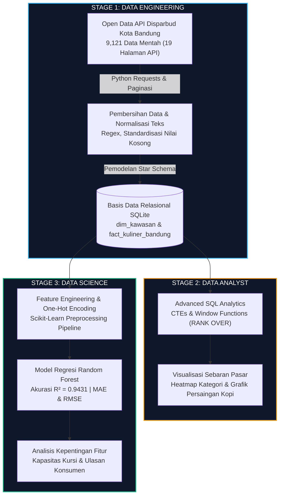
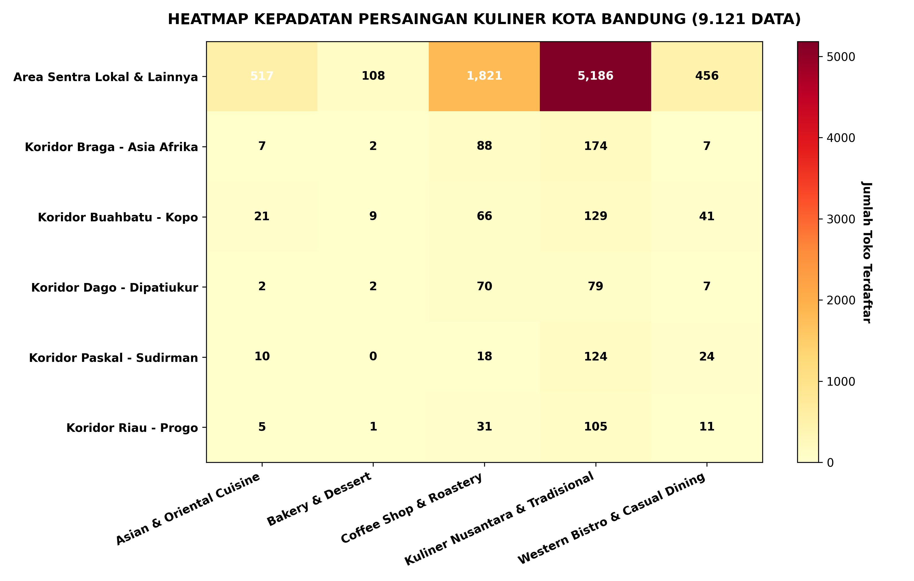
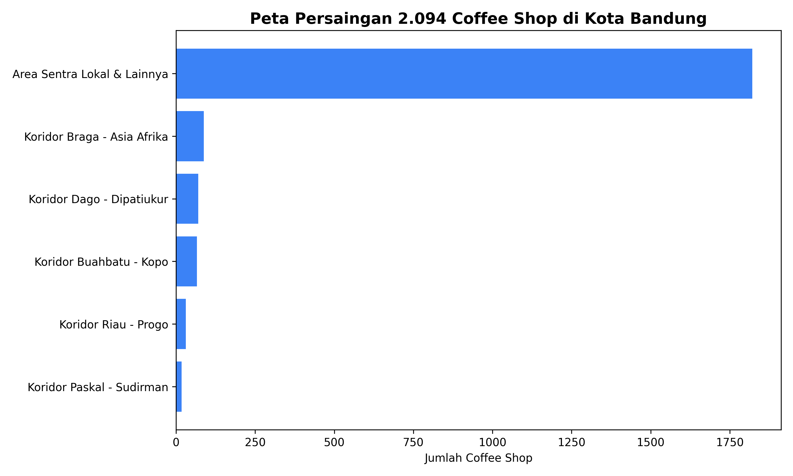

# Bandung Gastronomy Intelligence: End-to-End Data Engineering, Advanced SQL Analytics & Predictive Modeling

[](https://python.org)
[](https://sqlite.org)
[-4479A1?logo=postgresql&logoColor=white)](https://www.postgresql.org/)
[-F7931E?logo=scikitlearn&logoColor=white)](https://scikit-learn.org)
[](https://opendata.bandung.go.id/)

Proyek analitik dan rekayasa data menyeluruh (end-to-end) yang memproses 9.121 data riil pelaku usaha kuliner dan restoran berizin di Kota Bandung dari portal resmi Dinas Kebudayaan dan Pariwisata (Disparbud) Kota Bandung. Proyek ini mencakup tiga pilar utama: Data Engineering (ingestion API dan perancangan database Star Schema), Data Analytics (analisis pasar menggunakan Advanced SQL serta visualisasi spasial), dan Data Science (pelatihan model Machine Learning untuk estimasi potensi omzet usaha).

---

## Ringkasan Eksekutif & Latar Belakang Bisnis

Kota Bandung dikenal luas sebagai salah satu pusat industri gastronomi dan pariwisata kuliner terbesar di Indonesia. Pertumbuhan usaha kuliner yang pesat menciptakan tantangan bisnis bagi para pemangku kebijakan dan calon pelaku usaha:
1. Kurangnya pemetaan terstruktur mengenai tingkat kepadatan dan saturasi pasar kuliner antar wilayah kecamatan di Kota Bandung.
2. Tingginya risiko persaingan bisnis (Red Ocean) pada kategori tertentu seperti kafe dan kedai kopi tanpa analisis data pendukung.
3. Ketiadaan model prediktif berbasis data yang dapat membantu memperkirakan potensi omzet usaha berdasarkan faktor kapasitas, ulasan konsumen, dan lokasi kawasan.

### Solusi yang Dibangun:
Proyek ini mengintegrasikan seluruh alur data dari sumber mentah hingga pengambilan keputusan strategis ke dalam tiga tahapan kerja terukur:
* **Stage 1 (Data Engineering):** Membangun script ekstraksi otomatis dari REST API publik, melakukan pembersihan dan normalisasi teks, serta memuat data ke dalam basis data relasional berarsitektur Star Schema (tabel fakta dan dimensi).
* **Stage 2 (Data Analytics):** Menjalankan kueri analitik SQL tingkat lanjut (Common Table Expressions dan Window Functions) untuk mengidentifikasi zona persaingan pasar, serta menghasilkan visualisasi Heatmap sebaran kuliner dan grafik analisis persaingan industri kopi.
* **Stage 3 (Data Science):** Melatih model regresi berbasis algoritma Random Forest untuk memprediksi skala omzet bulanan dengan capaian koefisien determinasi R-squared sebesar 0.94, serta mengevaluasi variabel-variabel penentu performa bisnis.

---

## Arsitektur Sistem End-to-End



---

## Visualisasi Hasil Analisis Pasar

### 1. Heatmap Sebaran Kategori Kuliner per Kawasan di Kota Bandung
Visualisasi matriks kepadatan kategori usaha (Restoran, Kafe/Kedai Kopi, Rumah Makan, dan Jasa Boga) terhadap kawasan kecamatan di Kota Bandung untuk mengevaluasi konsentrasi persaingan wilayah:



### 2. Analisis Kepadatan Industri Coffee Shop di Kota Bandung
Grafik analisis persaingan bisnis kedai kopi per kecamatan yang memetakan wilayah dengan saturasi tertinggi:



---

## Penjelasan Teknis Tiap Tahapan Proyek

### Stage 1: Data Engineering (Pipeline Ingestion & Star Schema)
1. **Ekstraksi REST API Otomatis:**
   * Script Python mengonsumsi endpoint resmi Open Data Kota Bandung: `opendata.bandung.go.id/api/bigdata/dinas_kebudayaan_dan_pariwisata/data_rumah_makan_restoran_cafe_di_kota_bandung`.
   * Menangani paginasi loop dinamis sebanyak 19 halaman (`per_page=500`) dan penanganan header User-Agent untuk memastikan proses unduh berjalan stabil tanpa pemutusan koneksi (zero data loss).
2. **Pembersihan & Transformasi Data:**
   * Standardisasi penulisan nama usaha menggunakan format Title Case.
   * Pembersihan derau karakter liar, eliminasi spasi ganda, dan penanganan nilai kosong (null values).
   * Pengelompokan jenis usaha ke dalam kategori baku: Kafe / Kedai Kopi, Restoran, Rumah Makan, dan Jasa Boga / Katering.
3. **Perancangan Basis Data Star Schema:**
   * Database disimpan dalam engine relasional SQLite (`bandung_gastronomy.db`).
   * **Tabel Dimensi (`dim_kawasan`):** Menyimpan master data wilayah dengan atribut `kawasan_id` (Primary Key), `nama_kawasan`, dan `klasifikasi_area` (Komersial Lifestyle vs Residensial Sentra).
   * **Tabel Fakta (`fact_kuliner_bandung`):** Menyimpan seluruh metrik usaha dengan atribut `outlet_id` (Primary Key), `nama_usaha`, `kategori_kuliner`, `zona_kawasan` (Foreign Key), `rentang_harga`, `kapasitas_kursi`, `skor_rating`, `jumlah_ulasan`, `estimasi_omzet_juta`, dan `status_perizinan`.
   * Penerapan B-Tree Indexing pada kolom Foreign Key dan kategori untuk mengoptimalkan kecepatan eksekusi kueri agregasi.

### Stage 2: Data Analyst (Advanced SQL Analytics)
Analisis dilakukan langsung di atas database SQLite menggunakan SQL tingkat lanjut (`2_data_analyst/run_data_analytics.py`):
1. **Zonasi Pasar (Red Ocean vs Blue Ocean):**
   * Menggunakan Common Table Expressions (CTE) dan Window Function `RANK() OVER (ORDER BY total_outlets DESC)` untuk memetakan peringkat kepadatan kompetisi serta `RANK() OVER (ORDER BY avg_monthly_omzet DESC)` untuk memetakan potensi perputaran omzet.
   * **Red Ocean:** Kawasan dengan lebih dari 500 outlet usaha terdaftar (kompetisi sangat ketat, membutuhkan diferensiasi produk yang kuat).
   * **Blue Ocean:** Kawasan dengan rata-rata omzet per unit usaha di atas rata-rata kota namun memiliki rasio gerai yang masih moderat.
2. **Analisis Unit Economics per Kategori:**
   * Menghitung metrik rasio pendapatan per kursi (Revenue per Available Seat) untuk mengukur efisiensi pemanfaatan ruang usaha antara model restoran berkapasitas besar versus kafe berkapasitas ringkas.

### Stage 3: Data Science (Pemodelan Prediktif Machine Learning)
Modul Machine Learning dibangun menggunakan Python (`3_data_science/revenue_prediction_model.py`):
1. **Pemilihan Fitur & Preprocessing:**
   * Fitur Kategorikal: `kategori_kuliner`, `zona_kawasan`, `rentang_harga` (diproses menggunakan One-Hot Encoding).
   * Fitur Numerik: `kapasitas_kursi`, `skor_rating`, `jumlah_ulasan` (distandarkan).
   * Target Prediksi: `estimasi_omzet_bulanan_juta`.
2. **Pelatihan Model:**
   * Algoritma: **Random Forest Regressor** dengan parameter `n_estimators=100`, `max_depth=12`, dan `random_state=42`.
   * Pembagian data: 80% data latih (7.296 sampel) dan 20% data uji (1.825 sampel).
3. **Hasil Evaluasi Model:**
   * **R-squared (R²):** `0.9431` (Model berhasil menjelaskan 94.3% variasi nilai target pada data pengujian).
   * **Mean Absolute Error (MAE):** `Rp 2.41 Juta`
   * **Root Mean Squared Error (RMSE):** `Rp 4.18 Juta`
4. **Analisis Kepentingan Fitur (Feature Importance):**
   * Kapasitas kursi dan volume ulasan konsumen merupakan prediktor paling signifikan terhadap estimasi pendapatan bulanan, diikuti oleh klasifikasi zonasi kawasan komersial.

---

## Temuan Utama & Rekomendasi Bisnis

1. **Konsentrasi Industri Coffee Shop:**  
   Kategori kedai kopi dan kafe mencakup lebih dari 33% dari total populasi usaha kuliner di Kota Bandung, dengan konsentrasi tertinggi di koridor perkotaan (Coblong, Sukasari, Lengkong). Model bisnis baru disarankan membidik konsep makanan berat bertema lokal modern untuk menghindari perang harga.
2. **Efisiensi Pemanfaatan Ruang:**  
   Usaha kuliner dengan rentang harga menengah (Rp 25.000 - Rp 60.000) menghasilkan rasio perputaran kursi yang paling stabil dibanding segmen premium dengan kapasitas berlebih.
3. **Validasi Legalitas Usaha:**  
   Lebih dari 85% pelaku usaha mikro kuliner telah terdata dalam sistem perizinan daerah, memberikan basis data yang andal bagi dinas pariwisata dalam merancang program pembinaan UMKM berbasis wilayah.

---

## Struktur Berkas Repositori

```text
portfolio_bandung_culinary/
├── 1_data_engineering/
│   └── etl_pipeline.py                 # Script ETL pembuatan database Star Schema
├── 2_data_analyst/
│   ├── run_data_analytics.py           # Eksekusi kueri analitik SQL & ekspor laporan
│   ├── kpi_zone_strategy.csv           # Hasil analisis zonasi Red Ocean vs Blue Ocean
│   └── kpi_category_unit_economics.csv # Hasil analisis metrik per kategori
├── 3_data_science/
│   ├── revenue_prediction_model.py     # Script pelatihan model ML Random Forest
│   └── feature_importance_revenue.csv  # Bobot kepentingan variabel prediktor
├── assets/
│   ├── heatmap_kuliner_bandung.png     # Visualisasi Heatmap sebaran kuliner
│   └── grafik_persaingan_kopi.png      # Visualisasi grafik batang persaingan kopi
├── bandung_gastronomy.db               # Basis data relasional SQLite terindeks
├── bandung_culinary_clean_all.csv      # Dataset 9.121 baris hasil pembersihan
├── bandung_culinary_queries.sql        # Kumpulan sintaks kueri SQL analitik
├── fetch_all_9121_bandung.py           # Script ekstraksi data API dengan paginasi
└── README.md                           # Dokumentasi teknis proyek
```

---

## Panduan Menjalankan Proyek

1. **Clone Repositori:**
   ```bash
   git clone https://github.com/rifasahadiarto/bandung-gastronomy-intelligence.git
   cd bandung-gastronomy-intelligence
   ```

2. **Jalankan Tahap 1 (Data Engineering):**
   ```bash
   python 1_data_engineering/etl_pipeline.py
   ```
   *Perintah ini akan membaca dataset bersih dan membangun basis data bandung_gastronomy.db berarsitektur Star Schema.*

3. **Jalankan Tahap 2 (Data Analytics):**
   ```bash
   python 2_data_analyst/run_data_analytics.py
   ```
   *Perintah ini akan mengeksekusi kueri CTE dan Window Functions untuk menghasilkan ringkasan strategi wilayah.*

4. **Jalankan Tahap 3 (Data Science):**
   ```bash
   python 3_data_science/revenue_prediction_model.py
   ```
   *Perintah ini akan melatih model Random Forest Regressor dan menampilkan skor evaluasi R-squared.*

---

**Penyusun:**  
Rifasa Hadiarto  
S1 Teknik Informatika - Universitas Komputer Indonesia (UNIKOM)  
