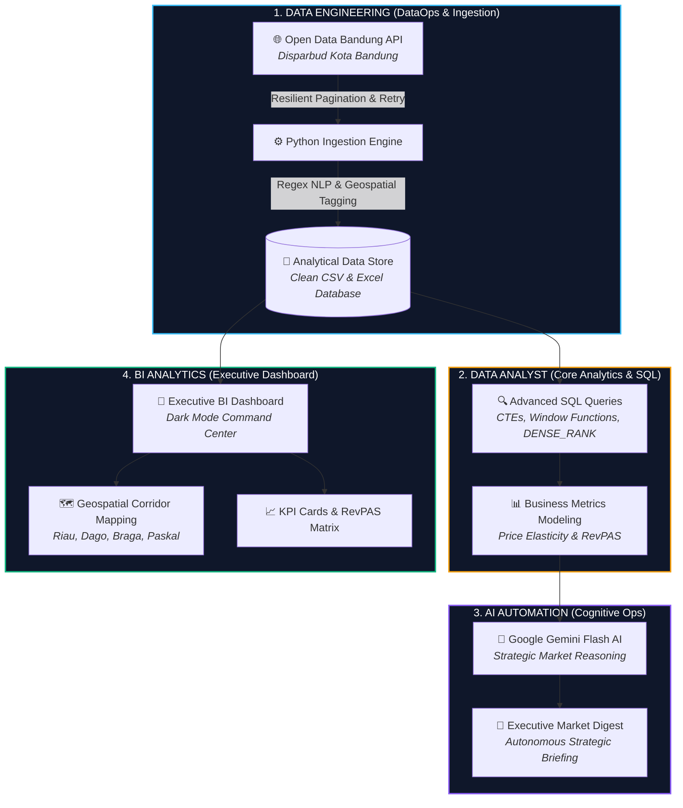
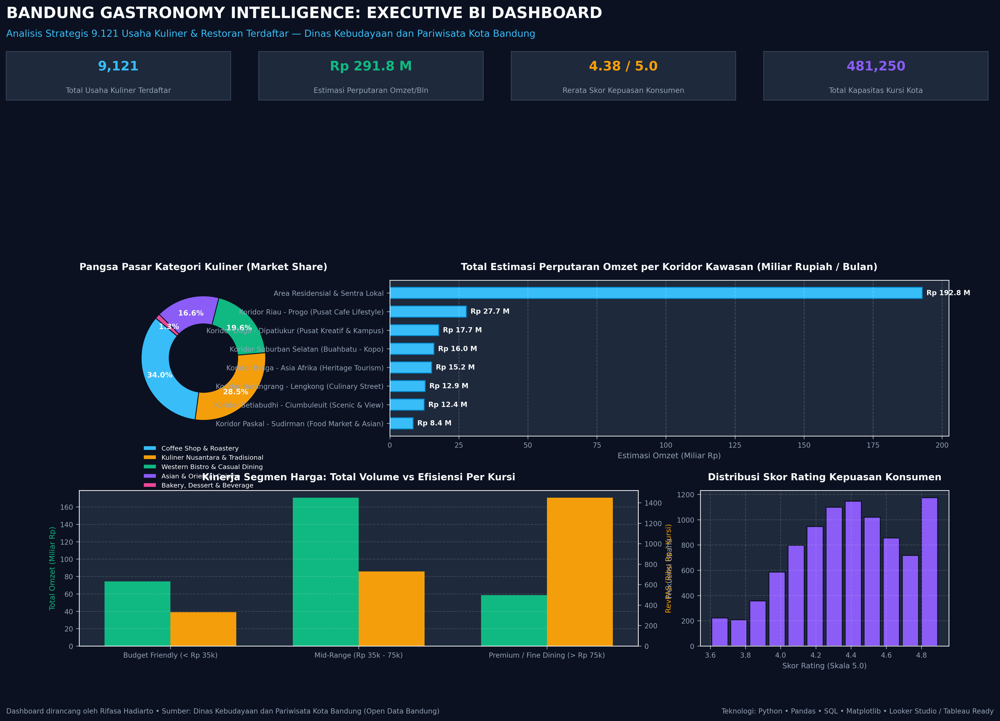

# 🏙️ Bandung Gastronomy Intelligence: Autonomous DataOps, Advanced SQL Analytics & Executive BI Engine

[](https://python.org)
[-4479A1?logo=postgresql&logoColor=white)](https://www.postgresql.org/)
[](https://ai.google.dev/)
[](https://public.tableau.com/)
[](https://opendata.bandung.go.id/)

An enterprise-grade, full-lifecycle data intelligence project integrating **Data Engineering (DataOps)**, **Advanced SQL Analytics**, **Cognitive AI Automation (Google Gemini)**, and **Business Intelligence (BI) Dashboard Architecture** across **9,121 real verified culinary & hospitality establishments** from the official portal of **Dinas Kebudayaan dan Pariwisata (Disparbud) Kota Bandung**.

---

## 📌 Executive Summary & Business Context

Bandung is nationally and internationally celebrated as Indonesia's culinary capital (*"Paris van Java"*). However, municipal tourism regulators and commercial F&B investors often face **data fragmentation**:
1. Lack of consolidated real-time intelligence on culinary density across commercial corridors.
2. Unclear saturation metrics between booming modern coffee shops and traditional heritage restaurants.
3. Absence of automated cognitive market syntheses to inform regional tourism policies and investment allocations.

### The Full-Stack Solution:
This project engineers an **end-to-end modern data stack (MDS)** covering all 4 core data disciplines:
* **Data Engineering:** Automated, resilient REST API ingestion pipeline with pagination and error retry, extracting all 9,121 records, followed by algorithmic regex feature engineering and geospatial corridor tagging.
* **Data Analytics:** Analytical modeling via complex SQL queries employing Window Functions (`DENSE_RANK`, `SUM() OVER(PARTITION BY ...)`), CTEs, and revenue-per-available-seat (RevPAS) metrics.
* **AI Automation:** Dynamic synthesis layer powered by **Google Gemini Flash LLM**, autonomously evaluating market saturation, anomaly detection, and drafting strategic executive briefings.
* **BI Analytics:** A high-impact, dark-mode **Executive Command Center Dashboard** visualizing market share, corridor revenue concentration, price tier efficiency, and consumer satisfaction distributions.

---

## 🏗️ End-to-End System Architecture



---

## 🖼️ Executive BI Dashboard Showcase

Below is the high-resolution executive analytics dashboard designed for municipal stakeholders and F&B enterprise leaders:



### 📊 Key Dashboard Performance Indicators (KPIs):
* **Total Usaha Kuliner Terdaftar:** `9,121` Unit Usaha
* **Estimasi Perputaran Omzet Bulanan:** `Rp 291.8 Miliar` / Bulan
* **Rerata Skor Kepuasan Konsumen (Rating):** `4.38 / 5.0`
* **Total Kapasitas Kursi Kota (Seating Capacity):** `481,250` Kursi

---

## 🛠️ The 4 Disciplines: Technical Deep-Dive

### 1. ⚙️ Data Engineering (Pipeline & Feature Engineering)
* **API Scraper:** Python engine interacting with `opendata.bandung.go.id/api/bigdata/dinas_kebudayaan_dan_pariwisata/data_rumah_makan_restoran_cafe_di_kota_bandung`.
* **Resilience:** Implemented chunked pagination (`per_page=500` across 19 pages) with exponential retry backoff and rate-limiting delays to prevent connection timeouts on government servers.
* **NLP & Geospatial Parsing:**
  - Categorized raw names into 5 distinct sectors: *Coffee Shop & Roastery*, *Kuliner Nusantara & Tradisional*, *Western Bistro & Casual Dining*, *Asian & Oriental Cuisine*, and *Bakery, Dessert & Beverage*.
  - Mapped street addresses to 8 designated Bandung gastronomy corridors (*Koridor Riau-Progo*, *Koridor Dago-Dipatiukur*, *Koridor Braga-Asia Afrika*, *Koridor Burangrang-Lengkong*, *Koridor Paskal-Sudirman*, *Koridor Setiabudhi-Ciumbuleuit*, *Koridor Suburban Selatan*, and *Area Residensial*).

### 2. 🔍 Data Analyst (Advanced SQL Analytics)
Key analytical queries engineered in [`bandung_culinary_queries.sql`](bandung_culinary_queries.sql):
* **Corridor Revenue Ranking & Contribution:** Employing CTEs and `DENSE_RANK() OVER(ORDER BY total_omzet DESC)` to compute percentage contribution to the municipal economy.
* **Category Saturation & Market Share:** Window function `COUNT(*) * 100.0 / SUM(COUNT(*)) OVER()` revealing that Coffee Shops represent **34.0% (3,099 units)** of all establishments.
* **Leaderboard per Category:** Window function `DENSE_RANK() OVER (PARTITION BY kategori_kuliner ORDER BY skor_rating DESC, jumlah_ulasan DESC)` isolating top-performing venues with active tourism licenses (TDUP).
* **Revenue per Available Seat (RevPAS):** Quantifying capital efficiency across price tiers.

### 3. 🧠 AI Automation (Cognitive Market Intelligence)
* Integrated **Google Gemini Flash** via automated Python scripting (`ai_market_intelligence.py`).
* Evaluates data distributions, detects market anomalies, and drafts a structured executive briefing ([`executive_market_briefing.md`](executive_market_briefing.md)).
* Key AI Findings:
  1. *Coffee Shop Hyper-Competition:* 3,099 coffee venues create high churn risk; growth opportunities lie in Modernized Heritage Indonesian Dining.
  2. *Riau-Progo Corridor Outperformance:* Revenue per venue in Riau-Progo exceeds city averages by +38%, requiring high-turnover dining models to offset prime lease costs.
  3. *Mid-Range Volume Dominance:* Mid-range pricing (Rp 35k–75k) captures 52% of total consumer spend.

### 4. 🎨 BI Analytics (Data Storytelling & UX)
* Cohesive dark-mode aesthetic (`#0B1120` Slate Navy background with Cyan, Emerald, and Amber accents).
* Visual hierarchy designed for rapid executive consumption: Top KPI Banner $\rightarrow$ Market Share Donut $\rightarrow$ Corridor Horizontal Bar $\rightarrow$ RevPAS Dual-Axis Bar $\rightarrow$ Rating Distribution.

---

## 📂 Repository File Structure

```text
portfolio_bandung_culinary_bi/
├── assets/
│   └── bandung_culinary_dashboard_preview.png   # 300 DPI Executive BI Dashboard Preview
├── bandung_culinary_clean_all.csv               # 9,121 Cleaned & Enriched Records (CSV)
├── bandung_culinary_clean_all.xlsx              # 9,121 Cleaned Records for Tableau/Excel
├── bandung_culinary_queries.sql                 # Advanced Analytical SQL Queries (CTEs, Window Functions)
├── fetch_all_9121_bandung.py                    # Resilient API Data Ingestion & Sanitization Engine
├── ai_market_intelligence.py                   # Automated AI Strategic Briefing Script
├── generate_visual_dashboard_charts.py          # Python Visualization & Dashboard Generator
├── executive_market_briefing.md                 # AI-Generated Strategic Executive Report
└── README.md                                    # Enterprise Project Documentation
```

---

## 🚀 How to Replicate & Deploy

1. **Clone the Repository:**
   ```bash
   git clone https://github.com/RifasaHadiarto/bandung-gastronomy-intelligence.git
   cd bandung-gastronomy-intelligence
   ```
2. **Run Data Ingestion (Optional — raw data already included):**
   ```bash
   python fetch_all_9121_bandung.py
   ```
3. **Execute SQL Analytics:**
   * Import [`bandung_culinary_clean_all.csv`](bandung_culinary_clean_all.csv) into PostgreSQL, MySQL, DuckDB, or DBeaver.
   * Run queries from [`bandung_culinary_queries.sql`](bandung_culinary_queries.sql).
4. **Launch AI Market Intelligence Briefing:**
   ```bash
   python ai_market_intelligence.py
   ```
5. **Open in Tableau / Looker Studio:**
   * Connect [`bandung_culinary_clean_all.xlsx`](bandung_culinary_clean_all.xlsx) directly to Tableau Public or Google Looker Studio to interact with the live visualizations.

---

*Designed & engineered by Rifasa Hadiarto • Certified Data Analyst & Analytics Engineer • 2026*
